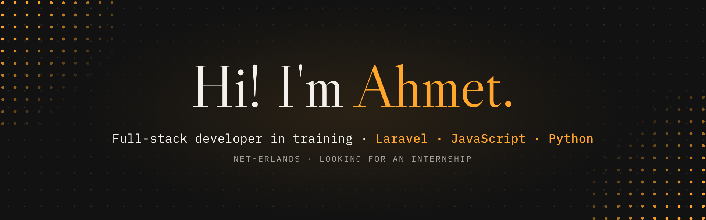
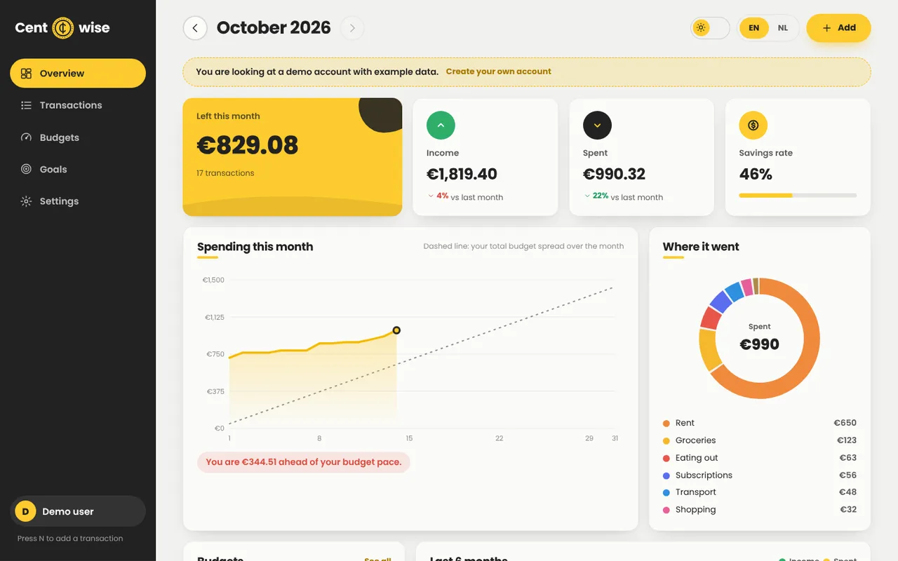
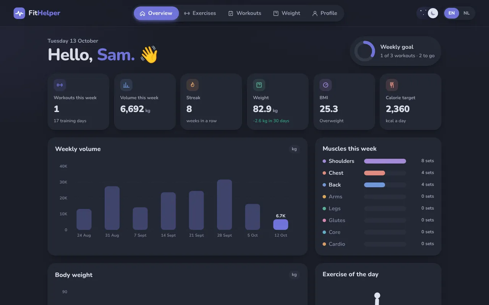
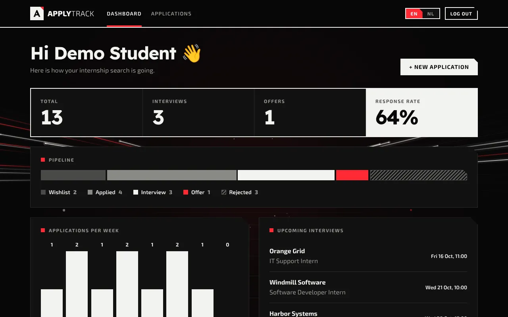
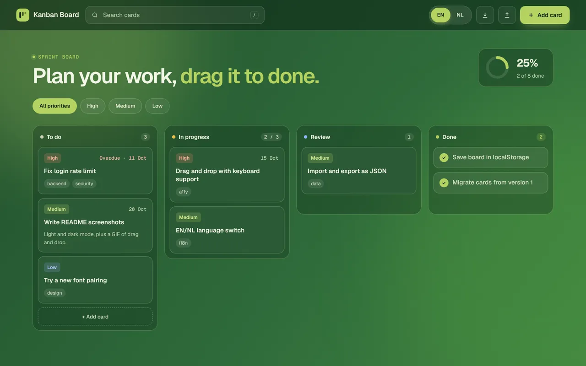

I'm a second-year MBO ICT student in the Netherlands, looking for a **full-stack internship**. I build web apps from the database to the last animation, and I make sure they are tested and easy to run.

**Portfolio:** [ahmetr42.github.io/portfolio](https://ahmetr42.github.io/portfolio/) · **Email:** [ahmet.resul.42@outlook.com](mailto:ahmet.resul.42@outlook.com) · I speak Dutch, English and Turkish

## Projects

<table>
  <tr>
    <td width="50%" valign="top">
      
      <h3><a href="https://github.com/AhmetR42/centwise">Centwise</a></h3>
      A budget app: a Laravel REST API with a JavaScript dashboard on top. Monthly budgets, a spending-pace chart and savings goals.  
      <code>Laravel</code> <code>Sanctum</code> <code>JavaScript</code> <code>SVG</code> <code>Docker</code>
    </td>
    <td width="50%" valign="top">
      
      <h3><a href="https://github.com/AhmetR42/FitHelper">FitHelper</a> · <a href="https://fithelper-3n3w.onrender.com/">live demo</a></h3>
      A workout tracker with 50 exercises, each shown by an animated figure. FastAPI backend with a REST API.  
      <code>Python</code> <code>FastAPI</code> <code>SQLModel</code> <code>JavaScript</code> <code>pytest</code>
    </td>
  </tr>
  <tr>
    <td width="50%" valign="top">
      
      <h3><a href="https://github.com/AhmetR42/applytrack">ApplyTrack</a></h3>
      Keeps every internship application in one place, with a status timeline, a dashboard and CSV export.  
      <code>Laravel</code> <code>PHP</code> <code>SQLite</code> <code>Blade</code> <code>PHPUnit</code>
    </td>
    <td width="50%" valign="top">
      
      <h3><a href="https://github.com/AhmetR42/kanban-board">Kanban Board</a> · <a href="https://ahmetr42.github.io/kanban-board/">live demo</a></h3>
      A task board that works without a server: drag and drop, autosave, undo and PDF export.  
      <code>JavaScript</code> <code>HTML</code> <code>CSS</code> <code>node:test</code>
    </td>
  </tr>
</table>

Every project has its own design, an English and Dutch interface, and tests that GitHub Actions runs on every push.

## What I work with

**Backend:** PHP, Laravel, Python, FastAPI, REST APIs, SQL (SQLite, MySQL)  
**Frontend:** JavaScript, HTML, CSS, SVG charts and animation, responsive layouts  
**Tools:** Git, GitHub Actions, Docker, PHPUnit, pytest
